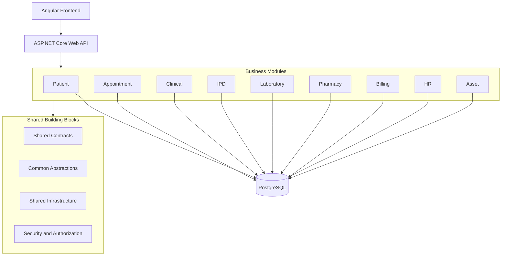
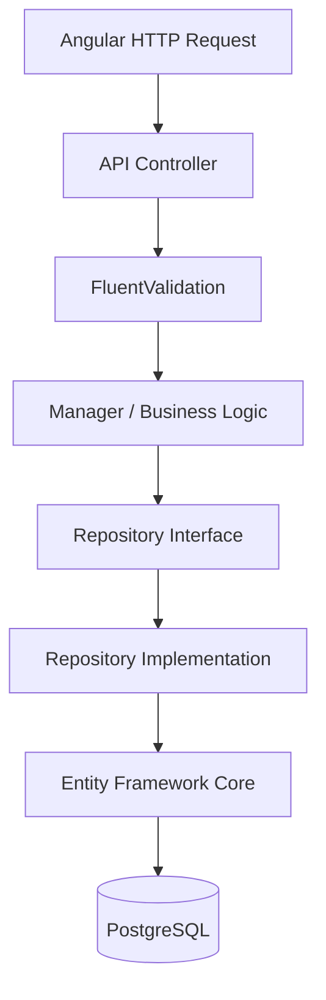

# Hospital Management Information System (HMIS)
# Technical Architecture & Development Standards

**Document Version:** 1.0  
**Document Type:** Technical Architecture Document (TAD)  
**Backend:** ASP.NET Core REST API  
**Target Framework:** .NET 8 baseline; assess .NET 10 LTS before project initialization  
**Frontend:** Angular (latest stable version at project initialization)  
**Database:** PostgreSQL  
**Architecture:** Modular Monolith  
**Design Principles:** Clean Architecture, SOLID, Separation of Concerns  
**Request Flow:** Controller → Manager → Repository  
**Validation:** FluentValidation  
**ORM:** Entity Framework Core / Npgsql

---

# 1. Architecture Overview

## 1.1 Architectural Vision

Build a scalable, maintainable, modular, and production-oriented HMIS using a Modular Monolith architecture.

Each business module must own its business logic, entities, repositories, managers, configurations, and PostgreSQL schema. The application initially runs as one deployable backend while preserving strict internal module boundaries.

## 1.2 Mandatory Architecture Decisions

| Area | Required Approach |
|---|---|
| Backend | ASP.NET Core REST API |
| Framework | .NET 8 baseline; assess supported LTS version before implementation |
| Architecture | Clean Architecture |
| Application architecture | Modular Monolith |
| Module organization | Schema per module |
| API design | RESTful API |
| Request flow | Controller → Manager → Repository |
| ORM | Entity Framework Core |
| Database | PostgreSQL with Npgsql |
| Frontend | Angular |
| Validation | FluentValidation |
| Mapping | Mapster |
| Logging | Serilog |
| Authentication | JWT / ASP.NET Core Identity |
| Authorization | RBAC and permission-based authorization |
| Persistence | Repository + Unit of Work where useful |
| Background processing | Hosted Services / Hangfire |
| Caching | Redis when justified |
| API documentation | Swagger / OpenAPI |
| Containerization | Docker | Docker Compose
| Testing | xUnit and integration testing |

## 1.3 Explicitly Prohibited Unless Approved

- MediatR.
- CQRS and Command/Query Handler architecture.
- Unnecessary microservices.
- Repository duplication.
- Unnecessary abstraction layers.
- Business logic inside controllers.
- Direct database access from controllers.
- Cross-module database manipulation.
- Static global service locators.

The architecture must remain straightforward, understandable, and maintainable.

---

# 2. High-Level Architecture

The system has three main areas:

1. Presentation Layer.
2. Business Modules.
3. Shared Building Blocks and Infrastructure.



All modules are part of one application deployment initially. They must not become a single undifferentiated codebase.

---

# 3. Modular Monolith and Module Boundaries

## 3.1 Proposed Business Modules

| Module | PostgreSQL Schema | Responsibility |
|---|---|---|
| Identity | auth | Users, roles, permissions |
| Administration | admin | Hospital settings and departments |
| Patient | patient | Patient information |
| Appointment | appointment | Scheduling and queues |
| Clinical | clinical | Diagnosis and prescriptions |
| OPD | opd | Outpatient visits |
| IPD | ipd | Admission and discharge |
| Emergency | emergency | Emergency operations |
| Nursing | nursing | Nursing operations |
| Laboratory | lab | Laboratory management |
| Radiology | radiology | Imaging management |
| Pharmacy | pharmacy | Medicine management |
| Inventory | inventory | Stock management |
| Billing | billing | Patient invoices and payments |
| Finance | finance | Accounting and financial management |
| HR | hr | Employee and payroll management |
| Asset | asset | Equipment and assets |
| Procurement | procurement | Purchasing and suppliers |
| OT | ot | Operation theatre |
| Blood Bank | bloodbank | Blood management |
| Reporting | reporting | Reports and analytics |
| Audit | audit | Audit records |

Schema names must be lowercase and consistent.

## 3.2 Module Isolation Rules

Each module owns its:
- Domain entities and business rules.
- DTOs and validators.
- Managers and repository interfaces.
- Repository implementations.
- Database configurations and migrations.
- API controllers or endpoints.
- Dependency injection registration.

Rules:
1. A module owns its schema and tables.
2. Another module must not directly update its tables.
3. Cross-module communication uses explicit contracts or events.
4. Do not share module-owned Domain Entities.
5. Avoid circular module dependencies.
6. Document module dependencies.
7. Foreign keys across schemas are allowed only when deliberately designed and do not replace application-level module ownership.

## 3.3 Database Strategy

Use one PostgreSQL database initially with separate schemas per module.

Benefits:
- One database infrastructure.
- Logical module separation.
- Cross-schema SQL capabilities.
- ACID transaction support.
- Simplified initial deployment and backup.

Logical module isolation must remain enforced even though modules share a physical database.

---

# 4. Clean Architecture Per Module

Each module follows Clean Architecture.

```text
Patient/
├── Domain/
│   ├── Entities/
│   ├── Enums/
│   ├── ValueObjects/
│   ├── Exceptions/
│   └── Constants/
│
├── Application/
│   ├── DTOs/
│   │   ├── Requests/
│   │   └── Responses/
│   ├── Interfaces/
│   │   ├── Managers/
│   │   └── Repositories/
│   ├── Managers/
│   ├── Validators/
│   ├── Mappings/
│   └── Services/
│
├── Infrastructure/
│   ├── Persistence/
│   │   ├── PatientDbContext.cs
│   │   ├── Configurations/
│   │   └── Migrations/
│   ├── Repositories/
│   └── DependencyInjection.cs
│
└── Presentation/
    └── Controllers/
```

These are logical responsibilities. Use separate .NET projects per module/layer where needed to enforce dependency boundaries.

## 4.1 Domain Layer

Contains:
- Entities.
- Value Objects.
- Domain Enums.
- Domain Exceptions.
- Entity relationships and invariants.

Rules:
- No dependency on EF Core.
- No dependency on ASP.NET Core.
- No dependency on Infrastructure.
- No HTTP or database access.

## 4.2 Application Layer

Contains:
- Manager interfaces and implementations.
- Repository interfaces.
- DTOs.
- Validators.
- Mapping configurations.
- Application workflows.
- Cross-module contracts and application services.

It coordinates workflows without depending on persistence implementations.

## 4.3 Infrastructure Layer

Contains:
- EF Core DbContext.
- Entity configurations.
- Repository implementations.
- Unit of Work implementation.
- Database migrations.
- External integrations.
- File storage and cache implementations.

## 4.4 Presentation Layer

Contains:
- Controllers.
- HTTP request binding.
- HTTP response handling.
- Authorization attributes and policies.
- API versioning.
- OpenAPI configuration.

Controllers must remain thin.

---

# 5. Controller → Manager → Repository

This is the mandatory request flow.



## 5.1 Controller Responsibilities

- Receive requests.
- Bind and validate request shape.
- Call manager methods.
- Apply authorization.
- Return standardized HTTP responses.
- Select appropriate HTTP status codes.

Controllers must not:
- Contain business workflows.
- Execute EF Core queries.
- Access DbContext directly.
- Perform complex calculations.
- Manipulate persistence entities directly.

Example:

```csharp
[ApiController]
[Route("api/v1/patients")]
public class PatientController : ControllerBase
{
    private readonly IPatientManager _patientManager;

    public PatientController(IPatientManager patientManager)
    {
        _patientManager = patientManager;
    }

    [HttpPost]
    public async Task<IActionResult> Create(
        [FromBody] PatientCreateDto request,
        CancellationToken cancellationToken)
    {
        var result = await _patientManager.CreateAsync(
            request, cancellationToken);

        return CreatedAtAction(
            nameof(GetById),
            new { id = result.Data?.Id },
            result);
    }

    [HttpGet("{id:guid}")]
    public async Task<IActionResult> GetById(
        Guid id,
        CancellationToken cancellationToken)
    {
        var result = await _patientManager.GetByIdAsync(
            id, cancellationToken);

        return Ok(result);
    }
}
```

The example illustrates the structure. Production code must map failures to the correct HTTP status instead of returning success status unconditionally.

## 5.2 Manager Responsibilities

Managers contain application business logic.

Examples:
- PatientManager.
- AppointmentManager.
- AdmissionManager.
- PrescriptionManager.
- InvoiceManager.
- PharmacyManager.

Responsibilities:
- Execute workflows.
- Apply business rules.
- Coordinate repositories.
- Coordinate other module contracts.
- Define transaction boundaries.
- Perform business validations.
- Map entities and DTOs.
- Return standardized results.

Example interface:

```csharp
public interface IPatientManager
{
    Task<ApiResponse<PatientResponseDto>> CreateAsync(
        PatientCreateDto request,
        CancellationToken cancellationToken);

    Task<ApiResponse<PatientResponseDto>> GetByIdAsync(
        Guid id,
        CancellationToken cancellationToken);
}
```

## 5.3 Repository Responsibilities

Repositories handle persistence operations:
- Insert.
- Update.
- Delete where permitted.
- Get by ID.
- Search and filtering.
- Pagination.
- Specialized database queries.

Repository methods must not contain hospital business workflows.

Example:

```csharp
public interface IPatientRepository
{
    Task<Patient?> GetByIdAsync(
        Guid id,
        CancellationToken cancellationToken);

    Task<Patient?> GetByMobileAsync(
        string mobile,
        CancellationToken cancellationToken);

    Task AddAsync(
        Patient patient,
        CancellationToken cancellationToken);
}
```

---

# 6. Shared Building Blocks

A dedicated Shared / BuildingBlocks area contains reusable components. Do not duplicate common implementations in every module.

## 6.1 Proposed Structure

```text
BuildingBlocks/
├── Common/
│   ├── Constants/
│   ├── Enums/
│   ├── Exceptions/
│   ├── Extensions/
│   ├── Helpers/
│   └── Utilities/
│
├── Contracts/
│   ├── Requests/
│   ├── Responses/
│   ├── Pagination/
│   └── IntegrationEvents/
│
├── Application/
│   ├── Interfaces/
│   ├── Services/
│   └── Abstractions/
│
├── Domain/
│   ├── BaseEntity.cs
│   ├── AuditableEntity.cs
│   └── IAggregateRoot.cs
│
├── Persistence/
│   ├── IRepository.cs
│   ├── IUnitOfWork.cs
│   └── BaseRepository.cs
│
└── Infrastructure/
    ├── Logging/
    ├── Caching/
    ├── FileStorage/
    └── BackgroundJobs/
```

Only genuinely reusable components belong here. Shared must not become a dumping ground for business logic.

## 6.2 Base Entities and Interfaces

Example:

```csharp
public abstract class BaseEntity
{
    public Guid Id { get; set; }
}

public abstract class AuditableEntity : BaseEntity
{
    public DateTime CreatedAt { get; set; }
    public Guid? CreatedBy { get; set; }
    public DateTime? ModifiedAt { get; set; }
    public Guid? ModifiedBy { get; set; }
}
```

Potential interfaces:
- IEntity.
- IAuditableEntity.
- ISoftDeletable.
- IHasConcurrencyToken.

Not every entity needs every interface. Immutable financial records must not support ordinary update or delete operations.

## 6.3 Common API Response

Use a consistent response contract.

```csharp
public class ApiResponse<T>
{
    public bool Success { get; set; }
    public string Message { get; set; } = string.Empty;
    public T? Data { get; set; }
    public List<ApiError> Errors { get; set; } = [];
    public string? TraceId { get; set; }
}

public class ApiError
{
    public string Code { get; set; } = string.Empty;
    public string Message { get; set; } = string.Empty;
    public string? Field { get; set; }
}
```

Rules:
- Successful requests use `Success = true`.
- Failed requests use `Success = false`.
- Validation errors identify affected fields.
- Never expose internal exception details.
- Include a trace identifier.
- HTTP status codes must accurately represent the result.
- Use Problem Details conventions where appropriate for standardized HTTP errors.

Recommended status codes:

| Status | Usage |
|---|---|
| 200 | Successful retrieval or operation |
| 201 | Resource created |
| 204 | Successful operation without response body |
| 400 | Invalid request |
| 401 | Unauthenticated |
| 403 | Forbidden |
| 404 | Resource not found |
| 409 | Business conflict |
| 422 | Semantic validation failure, if adopted |
| 500 | Internal server error |

Do not return HTTP 200 for every error.

## 6.4 Pagination Contracts

```csharp
public class PaginationRequest
{
    public int PageNumber { get; set; } = 1;
    public int PageSize { get; set; } = 20;
}

public class PagedResponse<T>
{
    public IReadOnlyList<T> Items { get; set; } = [];
    public int PageNumber { get; set; }
    public int PageSize { get; set; }
    public long TotalCount { get; set; }
    public int TotalPages { get; set; }
}
```

Requirements:
- Default page size 20.
- Maximum page size configurable, initially 100.
- Validate page number and page size.
- Use database-side pagination.
- Avoid loading entire tables into memory.
- Support sorting and filtering where required.

## 6.5 Common Interfaces

Consider reusable abstractions:
- IRepository<T>.
- IUnitOfWork.
- ICurrentUser.
- IRequestContext.
- IDateTimeProvider.
- IFileStorageService.
- ICacheService.
- INotificationService.
- IAuditService.
- IApplicationEventPublisher.

Create interfaces only where they provide a real boundary or reusable value.

---

# 7. Generic Repository & Unit of Work

## 7.1 Generic Repository

Use a generic repository for common persistence operations and module-specific repositories for complex queries.

Example:

```csharp
public interface IRepository<T> where T : class
{
    Task<T?> GetByIdAsync(
        Guid id,
        CancellationToken cancellationToken);

    Task AddAsync(
        T entity,
        CancellationToken cancellationToken);

    void Update(T entity);

    void Remove(T entity);
}
```

Rules:
- Complex queries belong in module-specific repositories.
- Do not expose IQueryable outside Infrastructure.
- Do not create generic methods for every possible SQL operation.
- Do not use generic deletion for immutable business records.
- Avoid duplicating EF Core functionality without a clear benefit.

## 7.2 Unit of Work

Unit of Work coordinates persistence and transaction boundaries.

```csharp
public interface IUnitOfWork
{
    Task<int> SaveChangesAsync(
        CancellationToken cancellationToken);

    Task BeginTransactionAsync(
        CancellationToken cancellationToken);

    Task CommitTransactionAsync(
        CancellationToken cancellationToken);

    Task RollbackTransactionAsync(
        CancellationToken cancellationToken);
}
```

The implementation must handle transaction disposal, nested-operation policy, and failure handling correctly.

Do not start and commit transactions independently inside every repository method.

## 7.3 Transaction Rules

- A normal module operation uses its own transaction boundary.
- Multiple repository changes in one module are committed together when required.
- Cross-module workflows require an explicit transaction strategy.
- Avoid distributed transaction assumptions.
- For immediate consistency across schemas in the same PostgreSQL database, coordinate one database transaction explicitly.
- For asynchronous cross-module workflows, use reliable event delivery and Outbox Pattern where appropriate.

---

# 8. Module-to-Module Communication

Modules communicate through explicit contracts, not by directly accessing another module's repositories or entities.

## 8.1 Shared Contracts

Example:

```text
BuildingBlocks/
└── Contracts/
    ├── Patient/
    │   └── IPatientLookup.cs
    ├── Billing/
    │   └── IBillingService.cs
    └── Events/
        ├── PatientRegisteredEvent.cs
        └── InvoicePaidEvent.cs
```

Contracts should expose only the minimum data and operations required by consumers.

## 8.2 Synchronous Communication

Use when the calling workflow needs an immediate result.

Examples:
- OPD retrieves a patient summary.
- Billing checks a service price.
- Admission checks bed availability.
- Pharmacy checks prescription information.

Example contract:

```csharp
public interface IPatientLookup
{
    Task<PatientSummaryDto?> GetPatientAsync(
        Guid patientId,
        CancellationToken cancellationToken);
}
```

Patient module implements the contract. The consuming module uses it through dependency injection.

## 8.3 Asynchronous Communication

Use when a module needs to notify others that something happened.

Examples:
- PatientRegistered.
- AppointmentCompleted.
- PatientAdmitted.
- InvoicePaid.
- PatientDischarged.
- MedicineStockUpdated.

Use application events and an Outbox Pattern when reliable delivery is required.

## 8.4 Restrictions

- Do not share Domain Entities between modules.
- Do not inject another module's DbContext.
- Do not directly update another module's tables.
- Do not create circular module dependencies.
- Do not put all business logic in Shared.
- Do not use events when an immediate response is required.
- Do not use synchronous HTTP calls between modules inside the same monolith.

Shared contains reusable abstractions and contracts, not ownership of business workflows.

---

# 9. FluentValidation Integration

FluentValidation is the standard request DTO validation framework.

## 9.1 Folder Structure

```text
Patient/
└── Application/
    └── Validators/
        ├── PatientCreateValidator.cs
        ├── PatientUpdateValidator.cs
        └── PatientSearchValidator.cs
```

## 9.2 Example Validator

```csharp
public class PatientCreateValidator
    : AbstractValidator<PatientCreateDto>
{
    public PatientCreateValidator()
    {
        RuleFor(x => x.FullName)
            .NotEmpty()
            .MaximumLength(150);

        RuleFor(x => x.MobileNumber)
            .NotEmpty()
            .MaximumLength(20);

        RuleFor(x => x.DateOfBirth)
            .LessThanOrEqualTo(DateTime.UtcNow);

        RuleFor(x => x.Gender)
            .IsInEnum();
    }
}
```

## 9.3 Validation Responsibilities

**DTO validation:**
- Required fields.
- Maximum length.
- Email and phone format.
- Numeric range.
- Enum values.
- Date formats.

**Business validation in Managers / domain rules:**
- Duplicate patient registration.
- Doctor availability.
- Bed availability.
- Invoice status.
- Prescription authorization.
- Stock availability.
- Financial transaction restrictions.

FluentValidation does not replace business invariants.

## 9.4 Validation Execution

Because the application does not use MediatR, implement a centralized MVC action filter or another explicit validation integration.

It must:
1. Identify request DTOs.
2. Resolve the matching validator.
3. Execute asynchronous validation with `ValidateAsync`.
4. Collect failures.
5. Return standardized 400 or 422 responses.
6. Prevent manager execution when validation fails.

Do not put asynchronous database validation into a synchronous MVC validation pipeline.

Do not rely exclusively on frontend validation.

## 9.5 Registration

Register validators from module Application assemblies, for example:

```csharp
services.AddValidatorsFromAssembly(
    typeof(PatientCreateValidator).Assembly);
```

Use centralized registration without creating dependencies between business modules.

---

# 10. Entity Framework Core & PostgreSQL Standards

## 10.1 Database Configuration

Use:
- EF Core and Npgsql.
- Code First migrations.
- Fluent API entity configurations.
- PostgreSQL schemas.
- Separate entity configuration classes.

Example:

```csharp
public class PatientConfiguration
    : IEntityTypeConfiguration<Patient>
{
    public void Configure(
        EntityTypeBuilder<Patient> builder)
    {
        builder.ToTable("Patients", "patient");

        builder.HasKey(x => x.Id);

        builder.Property(x => x.FullName)
            .HasMaxLength(150)
            .IsRequired();
    }
}
```

## 10.2 DbContext and Schema Ownership

Each module owns its DbContext and migration boundary, or an equally strict module-owned persistence boundary.

Examples:
- PatientDbContext.
- AppointmentDbContext.
- ClinicalDbContext.
- BillingDbContext.
- PharmacyDbContext.

All contexts may use the same PostgreSQL connection configuration while mapping only to their owned schemas.

Avoid creating a single DbContext that becomes the owner of every module's entities.

## 10.3 Migration Rules

- Each module owns its migrations.
- Use meaningful migration names.
- Never modify migrations already applied to production.
- Do not run automatic migrations on production application startup.
- Execute migrations through controlled deployment steps.
- Validate migration compatibility.
- Document migration dependencies and order.

## 10.4 PostgreSQL Best Practices

- Use UUID identifiers where appropriate.
- Use numeric/decimal for financial values; never float or double.
- Use `timestamptz` for timestamps.
- Store timestamps in UTC and display in Asia/Dhaka.
- Index frequently searched and joined columns.
- Use unique constraints for business identifiers.
- Use foreign keys and appropriate database constraints.
- Use JSONB for genuinely flexible metadata, not as a replacement for relational design.

## 10.5 Concurrency

Protect operations such as:
- Two receptionists allocating the same bed.
- Two cashiers paying the same invoice.
- Two pharmacists dispensing the same prescription.
- Two users editing the same record.

Use database transactions, unique constraints, appropriate locking, optimistic concurrency, and conditional updates.

Do not rely only on frontend checks.

---

# 11. Naming Conventions

| Item | Convention | Example |
|---|---|---|
| Class | PascalCase | PatientManager |
| Interface | I + PascalCase | IPatientManager |
| Method | PascalCase | CreateAsync |
| Property | PascalCase | FullName |
| Private field | _camelCase | _patientRepository |
| DTO | Entity + Purpose + Dto | PatientCreateDto |
| Validator | DTO + Validator | PatientCreateValidator |
| Repository | Entity + Repository | PatientRepository |
| Manager | Entity + Manager | PatientManager |
| Controller | Entity + Controller | PatientController |
| Schema | lowercase | patient |
| Table | Consistent PascalCase | Patients |
| Column | Consistent PascalCase | CreatedAt |
| Constant | PascalCase | DefaultPageSize |

Use `Async` suffix for asynchronous methods and `CancellationToken` for asynchronous I/O operations.

---

# 12. API Design Standards

## 12.1 Versioning

Use versioned routes:

```http
/api/v1/patients
/api/v1/appointments
/api/v1/billing/invoices
```

Configure versioning consistently.

## 12.2 REST Endpoints

Example:

```http
GET    /api/v1/patients
GET    /api/v1/patients/{id}
POST   /api/v1/patients
PUT    /api/v1/patients/{id}
PATCH  /api/v1/patients/{id}/status

GET    /api/v1/patients/{patientId}/visits
GET    /api/v1/patients/{patientId}/documents
```

Use resource-oriented routes and sub-resources where appropriate. Avoid unnecessarily long action-based route names.

## 12.3 API Requirements

- Standard response contracts.
- Pagination, filtering, sorting, and search.
- Correct HTTP status codes.
- Request validation.
- Cancellation tokens.
- Authorization.
- API versioning.
- OpenAPI documentation.
- Consistent exception handling.

## 12.4 API Security

- HTTPS.
- JWT authentication.
- Refresh token strategy where required.
- Role- and permission-based authorization.
- Sensitive information filtering.
- Rate limiting.
- Secure CORS configuration.
- Secure file access.

Never expose patient data simply because a user is authenticated.

---

# 13. Authentication & Authorization

Use a centralized Identity module.

```text
Identity Module
├── Users
├── Roles
├── Permissions
├── UserRoles
├── RolePermissions
├── UserPermissions
├── RefreshTokens
└── LoginHistory
```

Example permissions:

```text
Patient.View
Patient.Create
Patient.Update

Appointment.View
Appointment.Create
Appointment.Update
Appointment.Cancel

Billing.View
Billing.Create
Billing.Approve
Billing.Refund

Clinical.View
Clinical.Create
Clinical.Finalize
```

Support:
- Multiple roles per user.
- Configurable permissions.
- Department-level access.
- Ward-level access.
- Assigned-patient access.
- Doctor-patient relationship.
- Sensitive medical record access.

The backend must enforce permissions independently of Angular navigation and route guards.

---

# 14. Audit Logging

Audit logging is mandatory.

Capture:
- User ID.
- Action.
- Module.
- Entity and record ID.
- Timestamp.
- IP address where appropriate.
- Trace ID.
- Previous and new values where appropriate.

Audit important operations:
- Patient record changes.
- Clinical record creation.
- Prescription changes.
- Laboratory result verification.
- Admission and discharge.
- Billing, payment, and refund.
- Inventory adjustments.
- User permission changes.

Use immutable audit records and restrict audit access. Avoid storing unnecessary sensitive medical information in application logs.

---

# 15. Exception Handling & Logging

Implement centralized exception handling using ASP.NET Core exception-handling middleware.

Use meaningful custom exceptions where useful:
- BusinessException.
- NotFoundException.
- ValidationException.
- ConflictException.
- UnauthorizedException.
- ForbiddenException.

Map exceptions to appropriate HTTP responses. Do not repeat try/catch blocks in every controller.

Use Serilog for structured logging.

Log request metadata, status, duration, trace ID, exceptions, and important operational events.

Never log passwords, JWTs, refresh tokens, payment credentials, or unnecessary patient medical information.

Use correlation/trace IDs for troubleshooting.

---

# 16. Common Application Services

Create reusable abstractions where multiple modules need the same capability.

| Interface | Responsibility |
|---|---|
| ICurrentUser | Current authenticated user |
| IRequestContext | Request metadata and branch context |
| IDateTimeProvider | Consistent time abstraction |
| IFileStorageService | File upload and retrieval |
| ICacheService | Cache abstraction |
| IAuditService | Audit recording |
| INotificationService | Notification delivery |
| IEmailService | Email sending |
| ISmsService | SMS integration |
| IBackgroundJobService | Background job scheduling |
| IApplicationEventPublisher | Module event publishing |
| IUnitOfWork | Transaction management |

Keep abstractions in appropriate projects and implementations in Infrastructure.

Avoid injecting `IHttpContextAccessor` into every Manager. Prefer `ICurrentUser` or `IRequestContext`.

---

# 17. File & Document Management

Use centralized file storage for:
- Patient reports and prescriptions.
- Medical documents.
- Employee documents.
- Purchase invoices.
- Asset documents.

Create `IFileStorageService` with upload, download, controlled deletion, metadata, file size and MIME validation, ownership, categorization, and secure access.

Start with secure local or network storage if appropriate. Keep the implementation abstract so it can move to S3-compatible object storage later.

Do not store large binary files directly in PostgreSQL without a specific reason.

---

# 18. Background Jobs & Asynchronous Processing

Use background processing for:
- Email and SMS notifications.
- PDF generation.
- Report exports.
- Scheduled reminders.
- Expiry alerts.
- Daily summaries.
- Data synchronization.

Use ASP.NET Core `BackgroundService` for simple hosted processing and Hangfire for persistent scheduled or recurring jobs.

Rules:
- Jobs must be retry-safe.
- Use idempotency for financial or clinical operations.
- Record and monitor failures.
- Do not silently lose important events.
- Do not move critical synchronous business operations into background jobs.

Use Outbox Pattern for reliable cross-module event delivery where required.

---

# 19. Caching Strategy

Use Redis only where it provides measurable benefit.

Potential candidates:
- Hospital configuration.
- Department and designation lists.
- Medicine categories.
- Permission metadata.
- Frequently used reference data.

Avoid caching sensitive patient data by default.

Define expiration and invalidation. Do not use cache as the source of truth for financial transactions, authorization decisions, or bed allocation.

---

# 20. Angular Frontend Architecture

Use the latest stable Angular release available at project initialization, standalone components, and modern Angular APIs.

Recommended:
- Angular and TypeScript strict mode.
- Angular Router.
- Reactive Forms.
- HttpClient.
- RxJS.
- Angular Signals where appropriate.
- Angular Material or an approved UI component library.

## 20.1 Folder Structure

```text
src/app/
├── core/
│   ├── auth/
│   ├── guards/
│   ├── interceptors/
│   ├── services/
│   └── layouts/
│
├── shared/
│   ├── components/
│   ├── directives/
│   ├── pipes/
│   ├── models/
│   ├── utilities/
│   └── validators/
│
├── features/
│   ├── dashboard/
│   ├── patient/
│   ├── appointment/
│   ├── clinical/
│   ├── opd/
│   ├── ipd/
│   ├── emergency/
│   ├── nursing/
│   ├── laboratory/
│   ├── pharmacy/
│   ├── billing/
│   ├── finance/
│   ├── hr/
│   └── asset/
│
├── layouts/
│   ├── admin-layout/
│   ├── authentication-layout/
│   └── patient-layout/
│
├── app.config.ts
├── app.routes.ts
└── app.component.ts
```

## 20.2 Angular Rules

1. Each business module has its own feature folder.
2. Use lazy-loaded feature routes.
3. Use standalone components.
4. Use Reactive Forms for complex forms.
5. Use centralized API services.
6. Use interceptors for authentication and common error handling.
7. Use route guards for navigation permissions.
8. Reuse components for tables, dialogs, and forms.
9. Keep business logic out of components.
10. Enable TypeScript strict mode.
11. Avoid unnecessary state-management libraries.
12. Use Signals or RxJS according to actual requirements.

## 20.3 API Communication

Use feature-specific API services, for example:

```text
patient/
├── components/
├── pages/
├── services/
│   └── patient-api.service.ts
├── models/
├── validators/
└── patient.routes.ts
```

Do not make direct HTTP requests from every component.

## 20.4 UI/UX Standards

- Responsive layout.
- Consistent design system.
- Role-aware navigation.
- Searchable data tables.
- Server-side pagination.
- Reusable dialogs.
- Consistent validation.
- Loading, error, and empty states.
- Confirmation for destructive operations.
- Keyboard-friendly data entry.
- Accessible controls.

Clinical interfaces must prioritize speed, readability, and patient safety.

---

# 21. Testing Strategy

Use xUnit for backend tests.

## 21.1 Unit Tests
Test manager business logic, business rules, validators, calculations, permission checks, and status transitions.

## 21.2 Integration Tests
Test API endpoints, repositories, database operations, transaction behavior, module communication, authentication, and authorization.

Use a real PostgreSQL test database or disposable PostgreSQL containers. Do not assume SQLite behaves identically to PostgreSQL.

## 21.3 Frontend Tests
Test components, services, forms, route guards, interceptors, and important user workflows.

## 21.4 End-to-End Tests
Use Playwright or an equivalent browser testing framework.

Critical workflows:
- Patient registration.
- Appointment booking.
- OPD consultation.
- Prescription creation.
- Laboratory order.
- Admission and bed allocation.
- Billing and payment.
- Discharge.

## 21.5 Testing Rules
- Test every critical business workflow.
- Test important validators.
- Test financial calculations.
- Test concurrency-sensitive operations.
- Do not consider an endpoint complete without appropriate tests.

---

# 22. API Documentation & Developer Experience

Use Swagger/OpenAPI.

Document:
- API descriptions.
- Request and response examples.
- Authentication.
- Validation responses.
- HTTP status codes.
- API versions.

Maintain developer onboarding instructions so a new developer can clone the repository, configure environment variables, start PostgreSQL, apply migrations, run the API and Angular application, access Swagger, and execute basic workflows.

---

# 23. Deployment & DevOps

Suggested infrastructure:

```text
Hospital System
├── Angular Application
├── ASP.NET Core API
├── PostgreSQL
├── Redis (optional)
├── Background Worker
└── File Storage
```

## 23.1 Environments
- Development.
- Testing.
- Staging / UAT.
- Production.

## 23.2 Configuration and Secrets
Never commit database passwords, JWT secrets, API keys, SMTP credentials, or production connection strings. Use environment variables or a secure secret manager.

## 23.3 CI/CD Pipeline
1. Restore dependencies.
2. Build backend.
3. Run backend tests.
4. Build Angular.
5. Run frontend tests.
6. Run code-quality checks.
7. Build Docker images.
8. Deploy to the target environment.
9. Execute controlled migrations.
10. Run health checks.

## 23.4 Backup & Recovery
- Automated PostgreSQL backups.
- Point-in-time recovery where supported.
- Backup encryption.
- Retention policy.
- Regular restore tests.
- Documented disaster recovery procedure.

---

# 24. Recommended Solution Structure

```text
HospitalManagement/
├── src/
│   ├── Api/
│   │   ├── Controllers/
│   │   ├── Middleware/
│   │   ├── Filters/
│   │   ├── Extensions/
│   │   └── Program.cs
│   │
│   ├── BuildingBlocks/
│   │   ├── Common/
│   │   ├── Contracts/
│   │   ├── Domain/
│   │   ├── Application/
│   │   ├── Persistence/
│   │   └── Infrastructure/
│   │
│   ├── Modules/
│   │   ├── Identity/
│   │   │   ├── Domain/
│   │   │   ├── Application/
│   │   │   ├── Infrastructure/
│   │   │   └── Presentation/
│   │   ├── Patient/
│   │   ├── Appointment/
│   │   ├── Clinical/
│   │   ├── OPD/
│   │   ├── IPD/
│   │   ├── Emergency/
│   │   ├── Nursing/
│   │   ├── Laboratory/
│   │   ├── Radiology/
│   │   ├── Pharmacy/
│   │   ├── Inventory/
│   │   ├── Billing/
│   │   ├── Finance/
│   │   ├── HR/
│   │   ├── Asset/
│   │   ├── Procurement/
│   │   ├── OT/
│   │   ├── BloodBank/
│   │   ├── Reporting/
│   │   └── Audit/
│   │
│   └── Frontend/
│       └── hospital-ui/
│
├── tests/
│   ├── UnitTests/
│   ├── IntegrationTests/
│   └── ArchitectureTests/
│
├── docs/
├── docker/
├── scripts/
├── .editorconfig
├── .gitignore
├── docker-compose.yml
└── README.md
```

For a large project, use separate .NET projects for module boundaries where appropriate. Avoid one enormous project containing all module code.

---

# 25. Architecture Governance

Mandatory rules:

1. Follow the approved architecture.
2. Do not introduce CQRS or MediatR.
3. Use Controller → Manager → Repository.
4. Keep controllers thin.
5. Keep business logic in Managers or appropriate domain objects.
6. Use repositories for persistence.
7. Use Unit of Work for controlled persistence.
8. Use FluentValidation for request validation.
9. Keep module schemas isolated.
10. Do not access another module's repositories directly.
11. Use Shared Contracts for module integration.
12. Do not share module-owned entities.
13. Avoid circular dependencies.
14. Use asynchronous I/O and CancellationToken.
15. Use Mapster where beneficial.
16. Use structured logging.
17. Implement centralized exception handling.
18. Maintain audit trails.
19. Use transactions and concurrency controls for critical workflows.
20. Write unit, integration, and architecture tests.
21. Follow naming conventions.
22. Update documentation when architecture changes.
23. Never change approved business rules without approval.

---

# 26. Additional Architectural Recommendations

## 26.1 Architecture Tests

Use architecture tests to prevent unwanted dependencies.

Examples:
- Domain must not reference Infrastructure.
- Application must not reference Presentation.
- Patient module must not reference Billing repositories.
- Modules must not depend on each other's Infrastructure projects.
- Shared must not depend on business modules.

## 26.2 Idempotency

Implement idempotency for critical operations:
- Payment submission.
- Invoice payment.
- Prescription dispensing.
- Stock adjustment.
- External webhook processing.

The same request must not create duplicate financial or inventory transactions.

## 26.3 Outbox Pattern

Use Outbox when reliable event publishing is required.

Example, when an invoice is paid:
1. Billing records payment.
2. Billing records an Outbox event in the same transaction.
3. A background worker publishes the event.
4. Finance or another interested module processes it.
5. The event is marked processed.
6. Failed processing is retried safely.

Use event IDs and idempotent consumers to prevent duplicate processing.

## 26.4 Database Constraints

Protect important invariants at database level where practical:
- Unique patient numbers.
- Unique invoice numbers.
- Unique payment references.
- Valid foreign keys.
- Prevent overlapping active bed assignments using appropriate constraints or transactional logic.
- Non-negative stock constraints where appropriate.

## 26.5 Soft Delete and Record Lifecycle

Do not apply global soft delete to every table.

Use domain-specific lifecycle rules:
- Reference data may support soft deletion.
- Patient records may be deactivated or restricted according to retention policies.
- Finalized invoices must not be deleted.
- Posted vouchers must be reversed rather than deleted.
- Verified clinical reports must retain history.

## 26.6 Healthcare Data Privacy

Apply additional protection to medical records, patient identity, clinical notes, prescriptions, diagnostic results, employee information, and financial records.

Access to sensitive information must be controlled and auditable.

---

# 27. Development Implementation Sequence

## Stage 1: Solution Foundation
- Solution and project structure.
- Shared BuildingBlocks.
- API configuration.
- PostgreSQL connection.
- Authentication and authorization.
- Exception middleware.
- Common API response.
- Logging.
- FluentValidation.
- Generic Repository.
- Unit of Work.
- Swagger.
- Docker.

## Stage 2: Patient Reference Module
Implement Patient Management completely to validate the architecture:
- Domain entities.
- Application DTOs.
- Manager.
- Repository.
- Validators.
- DbContext and schema.
- Migration.
- Controller.
- API response.
- Angular feature.
- Unit and integration tests.

Patient becomes the architectural reference module.

## Stage 3: Module Integration
Implement Appointment and integrate with Patient using Shared Contracts. Demonstrate dependency injection, cross-module access, and no direct repository access or circular dependency.

## Stage 4: Operational Modules
Implement Clinical, OPD, IPD, Emergency, Nursing, Laboratory, and Radiology.

## Stage 5: Financial and Administrative Modules
Implement Billing, Pharmacy, Inventory, Procurement, Finance, HR, and Asset.

## Stage 6: Advanced Infrastructure
Implement background processing, Outbox, notifications, reporting, advanced audit, caching, monitoring, and performance optimization.

---

# 28. Instructions for Claude Code Agent

Treat this document as the mandatory technical architecture specification.

## 28.1 Initial Analysis
Before code generation:
1. Read the complete BRD.
2. Read this Technical Architecture document.
3. Identify conflicts and missing decisions.
4. Prepare solution structure and module dependencies.
5. Define database schema and DbContext strategy.
6. Define Shared BuildingBlocks.
7. Define dependency injection registration.
8. Define repository and Unit of Work strategy.
9. Define FluentValidation integration.
10. Define API response and exception handling.
11. Define authentication and authorization.
12. Define Angular architecture and testing strategy.

## 28.2 Architecture Review
Present:
- Final solution structure.
- Project dependency diagram.
- Module boundaries.
- Shared component list.
- Schema ownership.
- DbContext strategy.
- Repository and Unit of Work plan.
- Validation integration.
- API response design.
- Exception handling.
- Security.
- Angular architecture.
- Testing strategy.

Explain the purpose of each major component.

## 28.3 Implementation Rules
- Follow the approved architecture.
- Do not introduce CQRS or MediatR.
- Do not replace Managers with Handlers.
- Do not bypass repositories.
- Do not put business logic in controllers.
- Do not place module business logic in Shared.
- Do not create direct cross-module repository dependencies.
- Do not create unnecessary abstractions.
- Do not mark placeholders as complete.
- Do not silently change approved architecture.

## 28.4 Quality Control
After each module:
1. Build the solution.
2. Run tests.
3. Verify migrations.
4. Verify API contracts.
5. Verify authorization.
6. Verify module boundaries.
7. Verify cross-module communication.
8. Verify error handling.
9. Update documentation.
10. Update implementation status.

Maintain:
- `/docs/BRD.md`
- `/docs/TECHNICAL-ARCHITECTURE.md`
- `/docs/DATABASE-DESIGN.md`
- `/docs/MODULE-DEPENDENCIES.md`
- `/docs/SHARED-BUILDING-BLOCKS.md`
- `/docs/API-DESIGN.md`
- `/docs/CODING-STANDARDS.md`
- `/docs/SECURITY.md`
- `/docs/TESTING.md`
- `/docs/IMPLEMENTATION-STATUS.md`
- `/docs/CHANGELOG.md`

---

# 29. Initial Task for Claude Code

**Start with Architecture Foundation only. Do not implement all business modules.**

1. Analyze both the BRD and this Technical Architecture document.
2. Propose the final .NET solution structure.
3. Define Shared BuildingBlocks.
4. Define module dependency rules.
5. Define PostgreSQL schema and DbContext strategy.
6. Define Generic Repository and Unit of Work.
7. Define FluentValidation integration.
8. Define common API response and exception handling.
9. Define module-to-module communication.
10. Define Angular project structure.
11. Define dependency injection strategy.
12. Define testing strategy.
13. Identify architectural risks and missing decisions.

Present the architecture for review.

After approval, implement Stage 1: Solution Foundation. Test and approve the foundation before implementing Patient Management as the reference module. Do not proceed to Appointment Management until the Patient module demonstrates that the architecture works correctly.

---

# 30. Final Technical Principles

- **Architecture:** Modular Monolith.
- **Design:** Clean Architecture.
- **Backend:** ASP.NET Core REST API.
- **Frontend:** Angular.
- **Database:** PostgreSQL with Schema-per-Module.
- **Request Flow:** Controller → Manager → Repository.
- **Persistence:** EF Core + Repository + Unit of Work.
- **Validation:** FluentValidation.
- **Mapping:** Mapster.
- **Communication:** Shared Contracts, application services, and events.
- **Security:** JWT, RBAC, and permission-based authorization.
- **Logging:** Serilog.
- **Testing:** xUnit, integration tests, and architecture tests.
- **Deployment:** Docker and CI/CD.
- **Development:** Foundation → Patient Reference Module → Module Integration → Remaining Modules.

**Final Objective:** Build a maintainable, secure, testable, and extensible hospital management platform without unnecessary architectural complexity.
