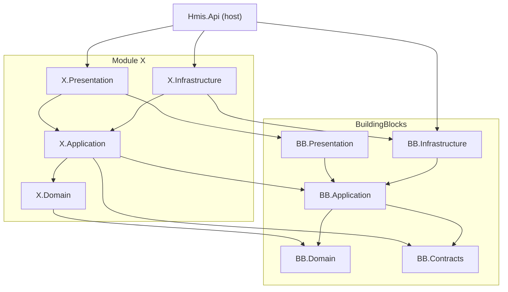

# HMIS — Final Architecture Proposal (Phase 0)

**Status:** Approved 2026-10-31  
**Date:** 2026-10-31  
**Sources:** `BRD.md`, `TECHNICAL-ARCHITECTURE.md` (the mandatory specification). This document records the concrete decisions taken on top of them.

---

## 1. Approved Decisions & Deviations

| # | Topic | Decision | Source / Note |
|---|---|---|---|
| D1 | Target framework | **.NET 10 LTS** | TAD said ".NET 8 baseline; assess .NET 10". Approved 2026-10-31. |
| D2 | Project granularity | **4 projects per module**: Domain, Application, Infrastructure, Presentation | Approved. A module's projects are created only when that module is built. |
| D3 | Branches | **Single facility only** — no `BranchId`, no branch-scoped permissions | Approved. BRD discovery Q1. |
| D4 | UI library | **Angular Material** (Angular 22, standalone, signals) | Approved. |
| D5 | Tests | **No test projects** (unit, integration, architecture) | **Deviation** from BRD §17 and TAD §21 — requested by the product owner. See `TESTING.md`. |
| D6 | Local database | PostgreSQL 17 in **Docker** (`docker-compose.yml`) | PostgreSQL is not installed locally. |
| D7 | Identifiers | `Guid` (UUID v7 via `Guid.CreateVersion7()`) generated in the application | Time-ordered UUIDs give better index locality. |
| D8 | Error flow | Managers **throw typed exceptions** for failures; global middleware maps them to HTTP status + `ApiResponse` | Avoids per-controller try/catch (TAD §15). |
| D9 | Identity store | Own `User`/`Role`/`Permission` entities in the `auth` schema, using ASP.NET Core Identity's **PasswordHasher (PBKDF2)**. The full `UserManager` stack is not used. | TAD §13. *Amended during Identity build:* keeps the Domain free of framework types and keeps Identity on Controller → Manager → Repository. |
| D11 | Local ports | PostgreSQL `5434`, API `7001/5001`, UI `4300` | 5432/5433/4200 are used by other local projects. |
| D12 | Timezone | Fixed to `Asia/Dhaka` and shown read-only in Settings | Single facility (D3); `IDateTimeProvider` uses the same zone, so the setting and the behaviour cannot diverge. |
| D13 | File storage | `IFileStorageService` with local disk storage outside the web root (`FileStorage:RootPath`), generated names, paths confined to the root | TAD §17; can be replaced by S3-compatible storage later. |
| D14 | Patient ID card | Printable HTML page with a Code 128 barcode (JsBarcode, MIT) instead of a server-generated PDF | Avoids a commercial PDF licence (e.g. QuestPDF above its revenue threshold); browsers can save as PDF. |
| D15 | Patient addresses/contacts | Stored as `jsonb` via value converters | Full old/new values appear in the audit trail; district is still queryable (`->>'District'`). |
| D16 | OPD visit and Clinical module | In Phase 2 the OPD visit **is** the checked-in appointment (Appointment owns the queue and status). Consultations, prescriptions and vitals live in a new **Clinical** module that refers to the encounter by `(EncounterType, EncounterId)`; Appointment exposes `IOpdEncounterService` to start/complete it. No separate `opd` schema yet. | A separate OPD visit table would duplicate the appointment 1:1 until Billing (Phase 3) adds visit charges; the encounter reference lets IPD and Emergency reuse Clinical later. Cross-module steps run in separate transactions and are idempotent (finalizing again only repeats the visit completion). |
| D17 | Billing and charge posting | Billing owns the price list, invoices, payments, discounts and refunds (`billing` schema). Other modules push charges through `IChargeService` (idempotent per source, e.g. one invoice per appointment); Billing never calls them back. The OPD fee is posted **before** the check-in is saved, so a failure leaves the patient not checked in and a retry is safe. Every money operation runs under a per-patient PostgreSQL advisory lock; database triggers block deleting financial rows and editing receipts. | Keeps module dependencies one-way (MODULE-DEPENDENCIES §1) without an outbox yet; the lock makes due amounts and advance balances safe against two cashiers at once; triggers back up BRD Module 17 rule 8 (never delete financial transactions). |
| D18 | IPD stays and running bills | IPD (`ipd` schema) owns bed categories (daily rate, suggested deposit), wards, beds and admissions. Bed rent goes to a **running bill**: a Billing draft invoice per stay to which IPD posts one line per bed day (`BED:yyyy-MM-dd`), idempotent by key. A background job (every 30 min, `Ipd:BedChargeIntervalMinutes`) and admission/transfer post due days; "Prepare final bill" fixes the discharge time, posts the last days and finalizes the bill. Deposits are ordinary advance deposits. Release (bed freed) needs a settled bill or an administrator's override with a reason. | Keeps Billing the single owner of money while IPD stays independent; per-day keys make repeated posting safe; the doctor's discharge order is never blocked by billing (BRD Module 05 safety rule). |
| D10 | Deferred infrastructure | Redis, Hangfire, Outbox are **not** built in Stage 1 | Built when a module actually needs them (TAD §19, §18). |

---

## 2. Solution Structure

Root: `D:\HMIS_App`

```text
HMIS_App/
├── Hmis.sln
├── Directory.Build.props            # net10.0, nullable, implicit usings, warnings-as-errors policy
├── Directory.Packages.props         # central NuGet version management
├── .editorconfig  .gitignore  README.md
├── docker-compose.yml               # postgres (+ api, ui later)
├── docker/                          # Dockerfiles, init scripts
├── scripts/                         # migration helper scripts
├── docs/
└── src/
    ├── Api/
    │   └── Hmis.Api/                # host: Program.cs, middleware, filters, auth wiring, Swagger
    ├── BuildingBlocks/
    │   ├── Hmis.BuildingBlocks.Domain/
    │   ├── Hmis.BuildingBlocks.Application/
    │   ├── Hmis.BuildingBlocks.Infrastructure/
    │   ├── Hmis.BuildingBlocks.Presentation/
    │   └── Hmis.BuildingBlocks.Contracts/      # cross-module interfaces, DTOs, integration events
    ├── Modules/
    │   ├── Identity/
    │   │   ├── Hmis.Modules.Identity.Domain/
    │   │   ├── Hmis.Modules.Identity.Application/
    │   │   ├── Hmis.Modules.Identity.Infrastructure/
    │   │   └── Hmis.Modules.Identity.Presentation/
    │   ├── Administration/   (same 4-project layout)
    │   ├── Audit/
    │   ├── HR/
    │   ├── Patient/
    │   └── ... later modules added when approved
    └── Frontend/
        └── hospital-ui/             # Angular 22 workspace
```

There is no `tests/` folder (decision D5).

---

## 3. Project Dependency Rules



| Project | May reference | Must NOT reference |
|---|---|---|
| `X.Domain` | `BB.Domain` | EF Core, ASP.NET Core, any other layer/module |
| `X.Application` | `X.Domain`, `BB.Application`, `BB.Contracts` | Infrastructure, Presentation, other modules |
| `X.Infrastructure` | `X.Application`, `BB.Infrastructure` (+ EF Core, Npgsql) | Presentation, other modules' projects |
| `X.Presentation` | `X.Application`, `BB.Presentation` | Infrastructure, other modules' projects |
| `Hmis.Api` | All `*.Presentation`, all `*.Infrastructure` (DI only), `BB.Infrastructure` | — |
| `BB.*` | Other `BB.*` per the diagram | **Any** business module |

**Cross-module rule:** A module never references another module's project. It uses an interface in `BB.Contracts` (for example `IPatientLookup`), which the owning module implements in its Infrastructure or Application layer and registers in DI.

---

## 4. Shared Building Blocks

| Project | Contents |
|---|---|
| **BB.Domain** | `BaseEntity` (Guid Id), `AuditableEntity` (CreatedAt/By, ModifiedAt/By), `IAuditableEntity`, `ISoftDeletable`, `IHasConcurrencyToken`, `IAggregateRoot`, `DomainException` |
| **BB.Application** | `ApiResponse<T>`, `ApiError`, `PaginationRequest`, `PagedResponse<T>`; exceptions (`BusinessException`, `NotFoundException`, `ConflictException`, `ValidationException`, `ForbiddenException`, `UnauthorizedException`); abstractions `IRepository<T>`, `IUnitOfWork`, `ICurrentUser`, `IRequestContext`, `IDateTimeProvider`, `IAuditService`, `IFileStorageService`; `PaginationRequestValidator`; Mapster global config hook |
| **BB.Infrastructure** | `BaseRepository<TEntity, TContext>`, `UnitOfWork<TContext>`, `ModuleDbContext` base (schema + per-schema migrations history), `AuditableEntityInterceptor` (stamps Created/Modified), `DateTimeProvider`, `LocalFileStorageService`, PostgreSQL/EF registration helpers |
| **BB.Presentation** | `ApiControllerBase` (helpers that return `ApiResponse` with correct status), `HasPermissionAttribute`, permission-definition contract (`IPermissionDefinitionProvider`) |
| **BB.Contracts** | Cross-module lookup interfaces and DTOs (`IPatientLookup`, `IDepartmentLookup`, `INumberSequenceService`, …) and integration event records. No business logic. |

Only components needed by two or more modules go into BuildingBlocks.

---

## 5. Persistence Strategy

### 5.1 Database & DbContexts
- One PostgreSQL database `hmis` with **one schema per module** (`auth`, `admin`, `audit`, `hr`, `patient`, …).
- Each module has **its own DbContext**, for example `PatientDbContext`. It derives from `ModuleDbContext`, which sets `HasDefaultSchema(schema)` and keeps the migrations history table in that schema (`patient.__EFMigrationsHistory`).
- Each module owns its own migrations folder (`X.Infrastructure/Persistence/Migrations`).
- Entity configuration uses Fluent API classes (`IEntityTypeConfiguration<T>`). Table and column names use PascalCase, as the TAD requires.
- Conventions: `timestamptz` for all `DateTime` values (stored in UTC; the UI displays Asia/Dhaka), `date` for `DateOnly`, `numeric(18,2)` for money, PostgreSQL `xmin` as the concurrency token on mutable aggregates.

### 5.2 Generic Repository + Unit of Work
- `IRepository<T>` provides `GetByIdAsync`, `AddAsync`, `Update` and `Remove`. Every module repository interface extends it with module-specific queries (search, paging). `IQueryable` never leaves Infrastructure.
- Each module has its own **`IUnitOfWork` implementation bound to its DbContext**. Managers call `SaveChangesAsync`, or `BeginTransactionAsync`/`CommitTransactionAsync` for multi-step workflows. Repositories never commit.
- Immutable records (finalized invoices, posted vouchers, audit logs) get repositories without `Update`/`Remove`.

### 5.3 Cross-module transactions (future)
These are not needed in Phase 1. When a workflow must be atomic across two schemas (for example Admission + Bed assignment), the owning manager opens one `NpgsqlConnection`/transaction and the other module's context joins it through `Database.UseTransaction`. Asynchronous consistency will use an Outbox, built when it is first needed.

### 5.4 Migrations
- Development: run `scripts/migrate.ps1`, which runs `dotnet ef database update` for each context in a documented order.
- Migrations are **never** applied automatically at production startup.
- Order: `auth` → `admin` → `audit` → `hr` → `patient` → later modules.

---

## 6. Request Pipeline

```mermaid
flowchart LR
    R[HTTP Request] --> CID[Correlation/Trace ID middleware]
    CID --> EX[Global exception middleware]
    EX --> SL[Serilog request logging]
    SL --> AU[JWT authentication]
    AU --> AZ[Permission authorization policy]
    AZ --> VF[FluentValidation action filter]
    VF --> C[Controller]
    C --> MG[Manager]
    MG --> RP[Repository]
    RP --> DB[(PostgreSQL)]
```



### 6.1 Validation (no MediatR)
- `[ApiController]`'s automatic 400 response is suppressed (`SuppressModelStateInvalidFilter = true`).
- A global **async action filter**, `FluentValidationFilter`:
  1. Converts any model-binding errors into `ApiResponse` errors.
  2. For each action argument, resolves `IValidator<TArg>` from DI. If one exists, it calls `ValidateAsync`.
  3. If validation fails, it returns **400** with `ApiResponse { Success=false, Errors=[{Code, Message, Field}] }` and the manager is not called.
- Validators are registered per module with `AddValidatorsFromAssembly(typeof(XApplicationMarker).Assembly)`.
- Business rules (duplicate patient, bed availability, …) stay in Managers and throw `BusinessException`/`ConflictException`.

### 6.2 API response & exception mapping

| Exception | HTTP | `ApiError.Code` |
|---|---|---|
| `ValidationException` | 400 | `VALIDATION_ERROR` |
| `UnauthorizedException` | 401 | `UNAUTHORIZED` |
| `ForbiddenException` | 403 | `FORBIDDEN` |
| `NotFoundException` | 404 | `NOT_FOUND` |
| `ConflictException`, `DbUpdateConcurrencyException`, unique-constraint violation | 409 | `CONFLICT` / `CONCURRENCY_CONFLICT` |
| `BusinessException` | 422 | specific code, e.g. `PATIENT_DUPLICATE` |
| Anything else | 500 | `INTERNAL_ERROR` (no internal details; full exception logged) |

Every response carries `TraceId`. Controllers inherit `ApiControllerBase` and use `OkResponse(...)`, `CreatedResponse(...)` and `NoContent()`.

---

## 7. Security

- **Authentication:** `User`/`Role` entities in the `auth` schema, with passwords hashed by ASP.NET Core Identity's PBKDF2 hasher. Short-lived **JWT access token (15 min)** plus a **rotating refresh token (7 days)**. The refresh token is stored as a SHA-256 hash and sent only as an `HttpOnly; Secure; SameSite=Strict` cookie scoped to `/api/v1/auth`. Reusing an old token revokes the whole token family.
- **Same-origin UI:** the Angular dev server proxies `/api` to the API (`proxy.conf.json`). In production a reverse proxy does the same, so the strict cookie works.
- **Authorization:** permission strings such as `Patient.View`.
  - Each module declares its permissions in an `IPermissionDefinitionProvider` (Presentation layer). On startup, Identity syncs these into `auth.Permissions`.
  - Endpoints use `[HasPermission(PatientPermissions.View)]`. A dynamic policy provider plus an authorization handler checks the user's effective permissions, which are the union of their roles' permissions plus direct user permissions.
  - Effective permissions are loaded from the database **once per request** (scoped). They are not cached across requests and not stored in the JWT, so revoking a permission takes effect immediately (TAD §19: cache is not the source of truth for authorization).
- **Lockout:** 5 failed logins lock the account for 15 minutes. Every login attempt is recorded in `auth.LoginHistory`.
- **Super Administrator seed:** created on first run from environment variables (`HMIS_ADMIN_EMAIL` and `HMIS_ADMIN_PASSWORD`). The password is never hardcoded.
- **Secrets:** read from environment variables or user-secrets in development and never committed. CORS is limited to the UI origin, and rate limiting applies to the auth endpoints.
- Details are in `SECURITY.md`.

---

## 8. Audit

- The `audit` module owns `audit.AuditLogs`, which is append-only. Its repository has no update or delete.
- `IAuditService.RecordAsync(...)` is in `BB.Application` and is implemented by the Audit module.
- **Entity change auditing:** `AuditSaveChangesInterceptor` (BB.Infrastructure) runs on every module DbContext. For entities marked `[Audited]` it records `Create` (new values), `Update` (only changed fields, old and new) and `Delete` (old values). It leaves out `[NotAudited]` properties, the Created/Modified stamps and the row version. An update that only touches excluded fields, such as login counters, produces no row.
- **Business events:** `IAuditService.Record(AuditEvent)` queues an event, such as `RolesChanged` or `PasswordReset`, which is written together with the next `SaveChangesAsync` in the same request. `RecordImmediateAsync` writes at once in its own transaction, for events with no data change such as sensitive reads.
- **Atomicity:** the interceptor writes audit rows with plain SQL (`IAuditLogWriter`, implemented by the Audit module) on the **same connection and transaction** as the change. If no transaction is active, it opens one around the save. Both directions were verified: a failed change leaves no audit row, and a failed audit write rolls the change back.
- **Append-only:** a database trigger rejects `UPDATE`, `DELETE` and `TRUNCATE` on `audit."AuditLogs"`. A retention purge needs a DBA to disable the trigger deliberately.
- Audited changes must be saved with `SaveChangesAsync`; the synchronous `SaveChanges` is rejected.
- Each record holds: UserId, Action, Module, EntityName, EntityId, Timestamp (UTC), IP address, TraceId, OldValues (jsonb), NewValues (jsonb).

---

## 9. Logging
- Serilog writes to the console and to rolling files (`logs/hmis-.log`) as compact JSON. It is enriched with TraceId, UserId, machine name and environment.
- Request logging records method, path, status and duration. Bodies are **not** logged.
- The following are never logged: passwords, tokens, payment credentials or clinical content.

---

## 10. Dependency Injection

Each module's Infrastructure project exposes one entry point:

```csharp
public static IServiceCollection AddPatientModule(this IServiceCollection services, IConfiguration config)
// registers DbContext, repositories, UnitOfWork, managers, validators, Mapster config, contract implementations
```

`Program.cs` calls `AddBuildingBlocks()` and then each `AddXModule()`. Controllers are found through `AddControllers().AddApplicationPart(typeof(PatientPresentationMarker).Assembly)` for each module. Managers and repositories are **scoped**. There is no static service locator.

---

## 11. Angular Frontend

- **Location:** `src/Frontend/hospital-ui`
- **Stack:** Angular 22, standalone components, strict TypeScript, Angular Material, Reactive Forms, Signals for UI state and RxJS for HTTP.
- **Structure:** follows TAD §20.1 (`core/`, `shared/`, `features/`, `layouts/`), with lazy-loaded routes for each feature.
- **`core/auth`:** login, token storage (access token in memory, refresh token in an HttpOnly cookie, or in storage if a cookie is not feasible; to be decided in the Identity module), and `AuthService` exposing `permissions()` as a signal.
- **Interceptors:** `authInterceptor` attaches the bearer token, `refreshInterceptor` handles 401 by refreshing once and retrying, and `errorInterceptor` maps `ApiResponse` errors to a snackbar or form errors.
- **Guards and directive:** `permissionGuard(...perms)` and a `*hasPermission` directive for role-aware menus. These only affect the UI; the backend enforces all permissions.
- **Shared components:** data table (server-side paging, sort, search), confirm dialog, page header, empty/error/loading states, and form-field error display.
- **Layouts:** `authentication-layout` (login) and `admin-layout` (sidenav, toolbar and breadcrumb). The navigation tree is in `NAVIGATION.md`.
- **Language:** English UI first, with strings written to be i18n-ready for Bangla later (open question).

---

## 12. Docker
- `docker-compose.yml` runs `postgres:17` with a named volume, plus pgAdmin as an optional profile. The API and UI images are added at the production-readiness stage.
- Development workflow: `docker compose up -d postgres`, run the migration script, `dotnet run` the API, then `ng serve`.

---

## 13. Architectural Risks

| Risk | Mitigation |
|---|---|
| No test projects → regressions undetected | Strict compile-time project boundaries; manual verification checklist per module recorded in `IMPLEMENTATION-STATUS.md`; Swagger smoke checks |
| Project count grows (~4 per module) | Create projects only for approved modules; `Directory.Build.props`/central packages keep them uniform |
| Cross-schema atomic workflows (IPD↔Bed, Billing↔Pharmacy) | Shared-connection transaction approach (§5.3) designed before Phase 3/4 |
| Ambiguous ownership (Doctor profile, Service master, Bed hierarchy, Encounter) | Proposed in `MODULE-DEPENDENCIES.md`; confirm in `OPEN-QUESTIONS.md` before those modules |
| Numbering collisions (MR / invoice numbers) | `admin.NumberSequences` with row-level lock (`SELECT … FOR UPDATE`) + unique constraint |
| Sensitive data leakage | Permission checks per endpoint, response DTOs exclude unnecessary fields, audit of sensitive reads |
