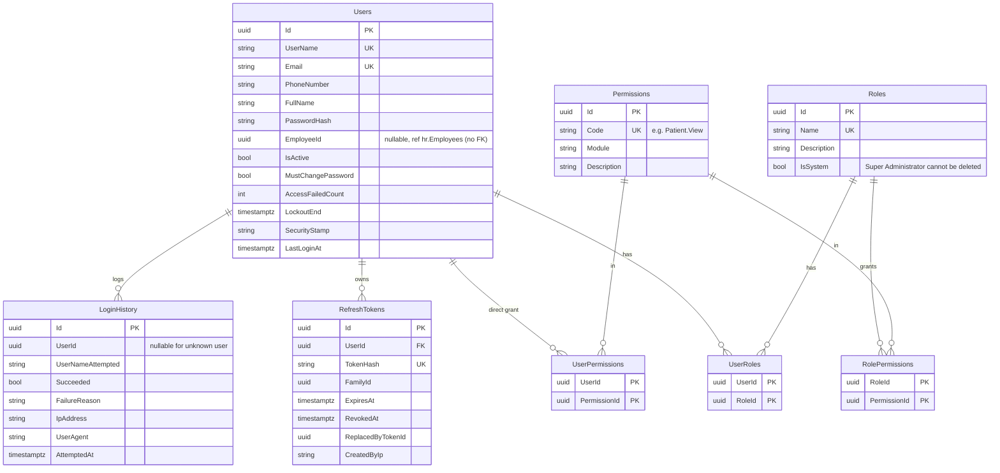
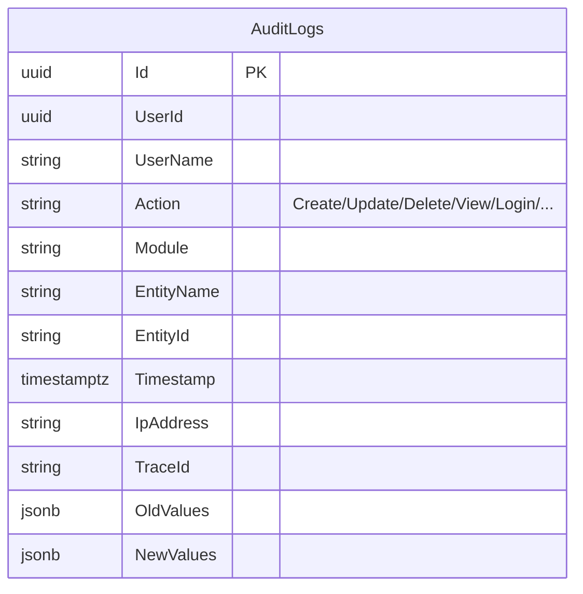
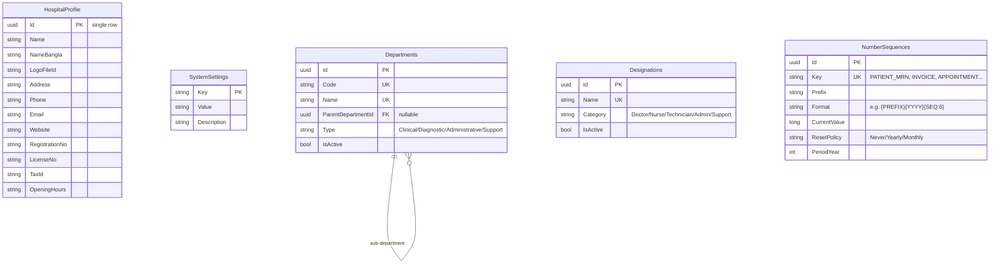
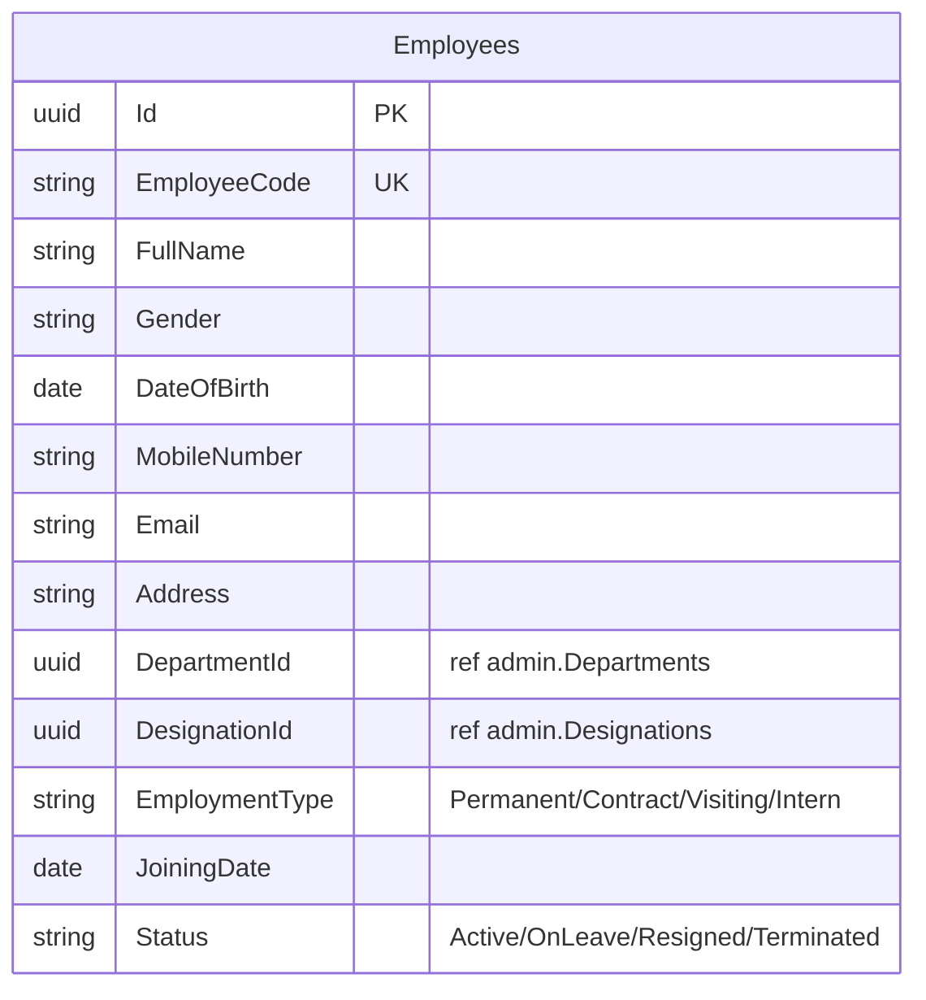
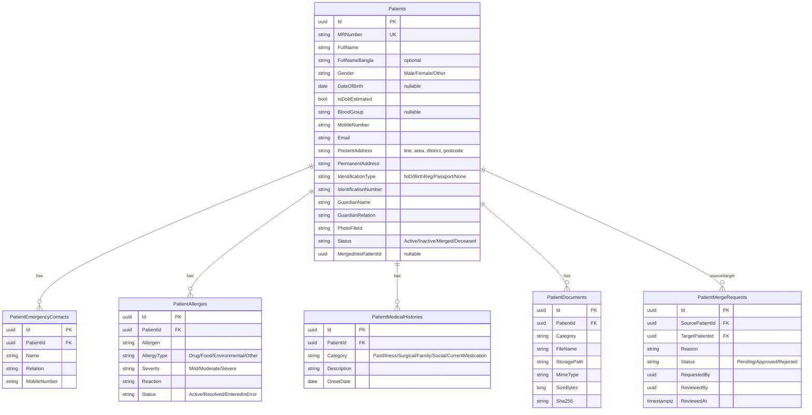

# Database Design

**Status:** Initial ERD for Phase 0–1 schemas. Proposed — awaiting approval.  
**Engine:** PostgreSQL 17, single database `hmis`, one schema per module.  
**Conventions:** PascalCase tables and columns, `uuid` primary keys (v7), `timestamptz` stored in UTC, `numeric(18,2)` for money, `xmin` for optimistic concurrency, and unique constraints on every business identifier.

Later-phase schemas will be designed in detail when each module is approved. The BRD §9 domain map is the starting point.

---

## 1. Schema Map

| Schema | Module | Phase |
|---|---|---|
| `auth` | Identity | 0 |
| `audit` | Audit | 0/1 |
| `admin` | Administration | 1 |
| `hr` | HR | 1 (basic) |
| `patient` | Patient | 1 |
| `appointment`, `clinical`, `opd` | Appointment, Clinical, OPD | 2 |
| `billing` | Billing | 3 |
| `ipd`, `nursing` | IPD + Bed, Nursing | 4 |
| `lab`, `radiology` | Laboratory, Radiology | 5 |
| `pharmacy`, `inventory`, `procurement` | — | 6 |
| `asset` | Asset | 7 |
| `emergency`, `ot`, `bloodbank` | — | 8 |
| `finance`, `reporting` | — | 9 |

---

## 2. Common Columns

| Column | Type | On |
|---|---|---|
| `Id` | uuid PK | every table |
| `CreatedAt`, `CreatedBy` | timestamptz, uuid | auditable entities |
| `ModifiedAt`, `ModifiedBy` | timestamptz null, uuid null | mutable auditable entities |
| `IsActive` | boolean | reference/master data (deactivate instead of delete) |
| `xmin` | system column | concurrency token on mutable aggregates |

`CreatedBy` and `ModifiedBy` store the user ID **without** a cross-schema foreign key. This keeps modules independent of `auth`.

---

## 3. ERD — `auth` (Identity)

The other ASP.NET Identity tables (claims, logins, tokens) are only created if they are needed.

---

## 4. ERD — `audit`

The table is append-only: there is no update or delete path in the application, and trigger `TR_AuditLogs_AppendOnly` rejects `UPDATE`, `DELETE` and `TRUNCATE`. `OldValues` and `NewValues` are `jsonb`. Indexes: `(Timestamp DESC)`, `(EntityName, EntityId)`, `(UserId, Timestamp)`, `(Module, Timestamp)`.

---

## 5. ERD — `admin` (Administration)

**As built:** `SystemSettings` is a typed single-row table (TimeZone fixed to `Asia/Dhaka`, CurrencyCode, CurrencySymbol, FinancialYearStartMonth with a 1–12 check), not a key/value table. `HospitalProfile` stores `LogoPath`/`LogoContentType` (file in `IFileStorageService`, not in the database). `Departments` have a unique `Code` and `NormalizedName`, and a self-referencing FK limited to two levels by the domain. `Designations` have a unique `NormalizedName`. Enums are stored as strings.  
`NumberSequences` allocation is a single `UPDATE … SET "CurrentValue" = … RETURNING` statement (row lock, yearly reset in the same statement), run on the Administration connection. Numbers are unique, but gaps are possible if the caller's own transaction later fails. `CurrentValue >= 0` is enforced by a check constraint.

---

## 6. ERD — `hr` (basic, Phase 1)

**As built:** adds `ExitDate` (required when the status is Resigned/Terminated, on or after joining). `EmployeeCode` is unique and generated from the `EMPLOYEE_CODE` sequence. Gender, EmploymentType and Status are stored as strings. Indexes: `(DepartmentId, Status)`, `DesignationId`, `MobileNumber`, `FullName`. `auth.Users.EmployeeId` has a unique filtered index (one login per employee).  
Attendance, leave, payroll, documents and the doctor profile are added in later phases.

---

## 7. ERD — `patient` (reference module)

**Indexes:**
- `MRNumber` (unique) and `MobileNumber`.
- A `pg_trgm` GIN index on `FullName` for fuzzy search and duplicate detection.
- `(IdentificationType, IdentificationNumber)`: unique where not null. *Needs confirmation.*

Patient visits, admission history, billing and lab history are **not** stored in this schema. The patient profile pulls them from the owning modules through contracts.

> Field lists for Patient depend on answers in `OPEN-QUESTIONS.md` (mandatory fields, MR format, ID types, address structure).
