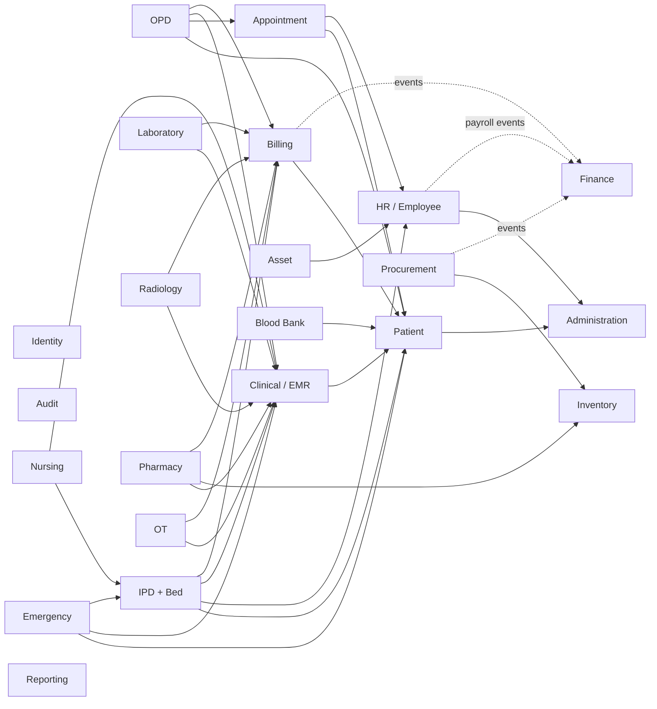

# Module Dependency Analysis

**Status:** Proposed — awaiting approval  
**Rule:** Modules depend only on `BuildingBlocks.Contracts` interfaces and events. They never depend on another module's projects. The arrows below mean "consumes a contract owned by".

## 1. Module Dependency Diagram

Identity, Administration and Audit are used by **every** module, through `ICurrentUser`, `IAuditService` and configuration lookups. Those edges are left out of the diagram to keep it readable. Reporting reads through read-only contracts or reporting views; it never writes to other modules.

**No cycles:** Billing must never call Clinical, OPD or IPD. Those modules push charges into Billing through `IChargeService` and are notified back by events such as `InvoicePaid`.

## 2. Dependency Table

| Module | Depends on (contracts) | Provides (contracts / events) | Phase |
|---|---|---|---|
| Identity | — | `ICurrentUser`, permission evaluation, `IUserLookup` | 0 |
| Administration | — | `IHospitalSettings`, `IDepartmentLookup`, `INumberSequenceService` | 1 |
| Audit | — | `IAuditService` | 0/1 |
| HR (basic) | Administration | `IEmployeeLookup`, `IDoctorLookup` | 1 (basic), 2 (doctor), 7 (full) |
| Patient | Administration (numbering) | `IPatientLookup`, `PatientRegistered` | 1 |
| Appointment | Patient, HR | `IAppointmentLookup`, `AppointmentCheckedIn` | 2 |
| Clinical / EMR | Patient | `IEncounterService`, `IPrescriptionLookup` | 2 |
| OPD | Patient, Appointment, Clinical, Billing | `OpdVisitCompleted` | 2 |
| Billing | Patient, Administration | `IChargeService`, `IServicePriceLookup`, `InvoicePaid` | 3 |
| IPD + Bed | Patient, HR, Clinical, Billing | `IBedAvailability`, `PatientAdmitted`, `PatientDischarged` | 4 |
| Nursing | IPD, Clinical | — | 4 |
| Laboratory | Clinical, Billing | `LabResultVerified` | 5 |
| Radiology | Clinical, Billing | `ImagingReportVerified` | 5 |
| Inventory | Administration | `IStockService` | 6 |
| Pharmacy | Clinical, Inventory, Billing | `MedicineDispensed` | 6 |
| Procurement | Inventory | `GoodsReceived` | 6 |
| Asset | HR, Administration | — | 7 |
| Emergency, OT, Blood Bank, Ambulance | Patient, Clinical, IPD, Billing | — | 8 |
| Finance | events from Billing, Procurement, HR | — | 9 |
| Reporting | read contracts from all | — | 9 |

## 3. Proposed Ownership of Ambiguous Concepts (needs confirmation)

| Concept | BRD mentions it in | Proposal | Reason |
|---|---|---|---|
| Doctor profile | Module 03 (Doctor), Module 14 (HR) | **HR** owns `Employee`. `DoctorProfile` (specialization, registration, fee) is an HR extension. **Appointment** owns `DoctorSchedules` and slots. | A doctor is an employee. Scheduling is an appointment concern. |
| Service master & prices | Module 01 (Admin), Module 17 (Billing) | **Billing** owns `ServiceCategories`, `Services` and `ServicePrices`. Admin only holds global billing settings (tax, currency). | Pricing is financial and needs an auditable price history. |
| Buildings / wards / rooms / beds | Module 01 (Admin), Module 13 (Bed) | **Administration** owns Buildings and Floors. **IPD** owns Wards, Rooms/Cabins, BedCategories, Beds and BedAssignments. | Bed status and assignment need the admission transaction. |
| Encounter | DB map "Medical" | **Clinical** owns `Encounters` (type OPD/IPD/ER, source ID). OPD, IPD and ER create them through `IEncounterService`. | Lab, Radiology and Pharmacy orders all reference one encounter concept. |
| Allergies, medical history | Module 02 (Patient), Clinical | **Patient** owns allergies and baseline medical history in Phase 1. Clinical owns diagnoses and prescriptions. | BRD lists them under Patient Features, and they are needed before Clinical exists. |
| Operation theatres (rooms) | Module 01, Module 11 | **OT** owns them. | Same reason as beds. |

### As built: one-way dependencies through extension points
- **HR → Administration:** `IDepartmentLookup`, `IDesignationLookup` (including batch `GetManyAsync`, so names are resolved without cross-schema joins), and `INumberSequenceService` for `EMPLOYEE_CODE`.
- **Administration ← HR (no reverse dependency):** Administration declares `IDepartmentUsageGuard`. HR implements it to block deactivating a department that has current employees. Administration calls every registered guard without knowing which modules exist.
- **Identity → HR:** `IEmployeeLookup`, so a login can be linked only to a current employee. One login per employee, enforced by a unique filtered index on `auth.Users.EmployeeId`.
- Modules declare their own number sequences through `INumberSequenceDefinitionProvider`; Administration creates any missing ones at startup.

## 4. Phase 1 Implementation Scope

As described in BRD Phase 0 and Phase 1, and the TAD's Stage 1 and Stage 2. **Each item still needs approval before it starts.**

| Step | Module | Scope |
|---|---|---|
| 1 | Foundation (Stage 1) | Solution, BuildingBlocks, Api host, Serilog, exception middleware, validation filter, Swagger, Docker Postgres, Angular shell (login page + admin layout) |
| 2 | Identity | Login, refresh, logout, change password, users CRUD, roles CRUD, permission assignment, lockout, login history, Super Admin seed |
| 3 | Audit | AuditLogs, interceptor, audit viewer (read-only, restricted) |
| 4 | Administration | Hospital profile, departments/sub-departments, designations, number sequences, basic settings (timezone, currency, financial year) |
| 5 | HR (basic) | Basic employee information (ID, name, contact, department, designation, joining date, status), and linking a user to an employee |
| 6 | Patient (reference module) | Registration, search, profile, MR number, duplicate detection, merge request, ID card (PDF), allergies, medical history, documents |

## Implemented (Phase 2, step 1)
- Appointment → Patient (`IPatientLookup`), HR (`IDoctorLookup`), Identity (`IUserEmployeeLookup`, to find the signed-in doctor), Administration (`INumberSequenceService`). No module depends on Appointment yet; `IAppointmentLookup` will be added when OPD needs it.

## Implemented (Phase 2, step 2)
- Clinical → Appointment (`IOpdEncounterService`: get/start/complete encounter, doctor–patient relationship), Patient (`IPatientLookup`, `IPatientClinicalSummary`), HR (`IDoctorLookup`, now with BMDC number), Identity (`IUserEmployeeLookup` incl. display names), Audit (`IAuditService`). Nothing depends on Clinical yet.

## Implemented (Phase 3)
- Billing → Patient (`IPatientLookup`), Identity (`IUserEmployeeLookup` names, `IPermissionChecker`), Administration (`INumberSequenceService`: INVOICE, RECEIPT, REFUND), Audit.
- Appointment → Billing (`IChargeService`: post the OPD fee at check-in, cancel the unpaid bill when a checked-in appointment is cancelled). Billing does not depend on Appointment.

## Implemented (Phase 4 step 1)
- IPD → Patient (`IPatientLookup`), HR (`IDoctorLookup`), Administration (`IDepartmentLookup`, `INumberSequenceService`: ADMISSION), Identity (`IUserEmployeeLookup`, `IPermissionChecker`), Billing (`IChargeService` running bills, `IPatientBalanceLookup`), Audit. Billing does not depend on IPD.
