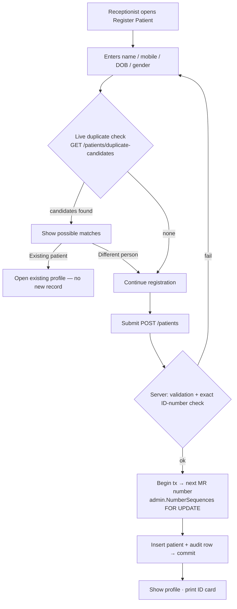
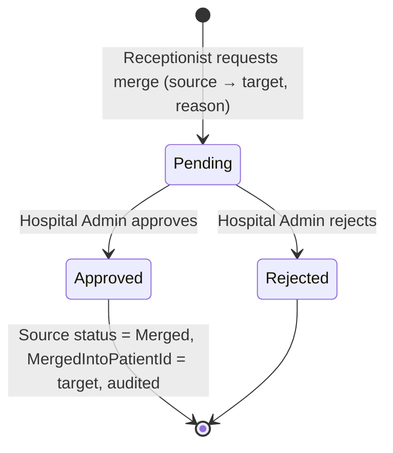

# Workflows

Cross-module workflows from BRD §5, with the owning module for each step. Each one gets a detailed state diagram when its phase is approved.

## Patient registration (Phase 1) — detailed

## Patient merge (Phase 1)

Records in other modules that point to the source patient are reassigned later through the `PatientMerged` event, once those modules exist.

## Cross-module overview (later phases)

| Workflow | Steps → owning module |
|---|---|
| OPD (P2) | Registration [Patient] → Appointment & Queue [Appointment] → Visit [OPD] → Consultation, Diagnosis, Prescription, Investigation [Clinical] → Charge [Billing] → Payment [Billing] → Completion [OPD] |
| IPD (P4) | Registration [Patient] → Admission + Bed [IPD] → Assessment / Treatment [Clinical] → Nursing [Nursing] → Investigations [Lab/Radiology] → Pharmacy → Daily charges [Billing] → Discharge summary [Clinical/IPD] → Final bill & payment [Billing] → Discharge [IPD] |
| Laboratory (P5) | Order [Clinical] → Authorization/billing [Billing] → Sample → Processing → Result → Verification → Publication [Lab] |
| Pharmacy (P6) | Prescription [Clinical] → Queue → Availability → FEFO batch → Dispense → Stock deduction [Inventory] → Invoice/Payment [Billing] |
| Procurement (P6) | Requisition → Approval → PO → GRN [Procurement] → Stock [Inventory] → Supplier invoice → Payment → Voucher [Finance] |
| Asset (P7) | Purchase → Registration → Assignment → Maintenance → Repair → Depreciation → Disposal [Asset] |

**Safety rules carried into every workflow:** payment must never block emergency care or a clinically necessary discharge; this requires an authorized exception path (BRD §5, §6).
